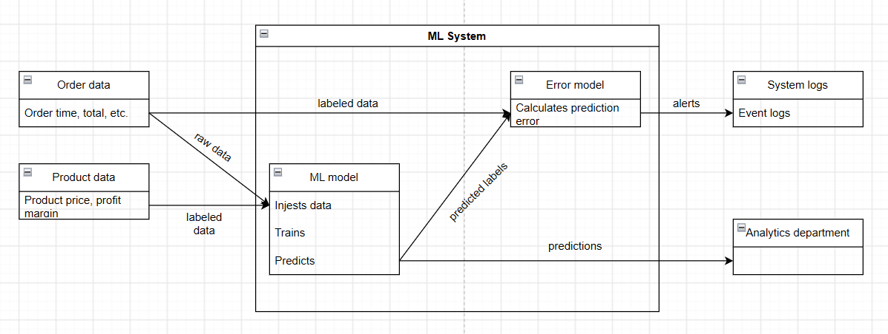
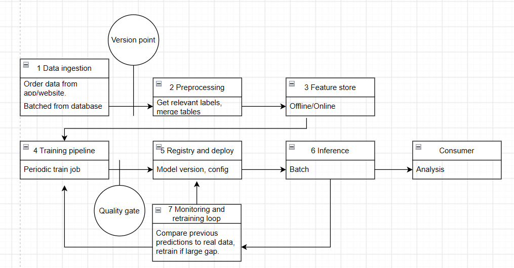

- 1 Overview. 

A system which predicts the sales revenue of various grocery products based on 
previous sales. New sales data is added daily and the predictions are adjusted accordingly.

- 2 Motivation. 

Model predictions are updated weekly based on new information and can
inform inventory purchases, product marketing and discounts with minimal delay.

Large discrepancies between predicted and actual values can be seen early and the model
adjusted in turn.

- 3 Success metrics. 

Model: MSRE for weekly revenue predictions should be as low as possible. 

Bussiness: It is assumed that low model error strongly correlates with better predictive
analysis and thus better serves bussiness goals.
Revenue overestimation is prefered over underestimation.

System: Inference time should be less than 1s for a week worth of data. 
Model should be trained on new data monthly, and retrained yearly or upon request.

- 4 Requirements and constraints. 

Inputs: Order information in daily batches (timestamp, total, additional info) 
from the database. Potentially multiple tables.

Outputs: Predictions for daily orders total/revenue for the next week 
(Predicted automatically and logged).
Automatic error calculation for the previous week's predictions with notifications in cases
of significant error.

---

New predictions outputed weekly.

Model is assumed to be local to the company, so latency is not that important. 
At least 1000 ms p95 is prefered.

Availability should be 100% at the start of the week for inference, unimportant for the rest of the week.
Predictions should be always available through third-party databases.

Predictions should be guaranteed within 20% of each other for same input.

Model should automatically train on new data monthly and be replaced yearly or on demand.

Ground truth labels available a week after prediction.

Cost limits set by company, assumed 0 budget.

Resource ceilings set by company, assumed my laptop capabilities)

- 5.1 Problem statement. 

Forecasting. 

Regression might be suitable for the task too, but the data is assumed to 
potentially have seasonality, so forecasting is prefered.

- 5.2 Data. 

Dataset: https://www.kaggle.com/datasets/akxiit/blinkit-sales-dataset?select=blinkit_orders.csv

New datapoints arrive immediately with most labels present, model injests them in batches
daily. 
Training data is assumed the same as serving data, but at an earlier point in time.

1. A time axis. Datapoints include timestamps and can arrive continuously.

2. Enough history to hold out a period. Data spans almost 2 years in time with multiple 
datapoints per day.

3. Labels with a known arrival delay. Prediction delay depends on the model's prediction
timeframe, in this case a week.

4. A text surface or a documented corpus. Dataset includes customer order feedback.

- 5.3 Techniques. 

Baseline: Basic regression model with the order items list as input and the order total
as output.

Candidate: Forecasting model combining several datasources (orders, order items, item profit
margin, etc.) producing these outputs for each day:
1. Orders total revenue

Useful for estimating bussiness success
2. Ordered items + their count

Useful for estimating future item demand and ordering inventory.
3. Profit

Useful for calculating company financial status.

- 5.4 Experimentation and validation. 

Monthly splits. Validation by MSRE.

- 5.5 Human in the loop. 

Auto-checking for prediction drift. Alert logs are viewed by ML engineers, who decide
if it should be trained/replaced/ignored.

- 6.1 High-level design. 

- 6.2 Infra. 

The local stack you will run and, per component, the managed cloud service you would use
instead. Use the component names and the cloud columns of the reference table in Appendix 3;
naming them is required, running on them is not.

- 6.3 Performance. 

Throughput and latency budgets, and the batch-versus-online decision with a
reason.

- 6.4 Security and 6.5 Data privacy. 

Where secrets live, who may call the service, what personal data
the dataset contains and how long you keep it. Short, but not empty.

- 6.6 Monitoring and alarms. 

What you will log, which metrics you will compute, which threshold will
fire, and who receives the alert. First draft; Lab 4 makes it real.

- 6.7 Cost. 

An estimated monthly cost of the cloud column, even though you will run locally. Use the
providers' calculators and state your assumptions.

- 6.8 Integration points. 

The upstream owner of the data, the downstream consumer of the
predictions, and the contract between you and each.

- 6.9 Risks and uncertainties. 

Named risks, one mitigation each.

- 7.1 Alternatives. 

At least two choices you rejected (a framing, a tool, a data source, an architecture)
with pros, cons and the reason.

- 7.2 and 7.3. Placeholders; Lab 2 and Lab 4 fill them.

- 7.4 Milestones. 

One sentence per later lab on what it will add to this system.
