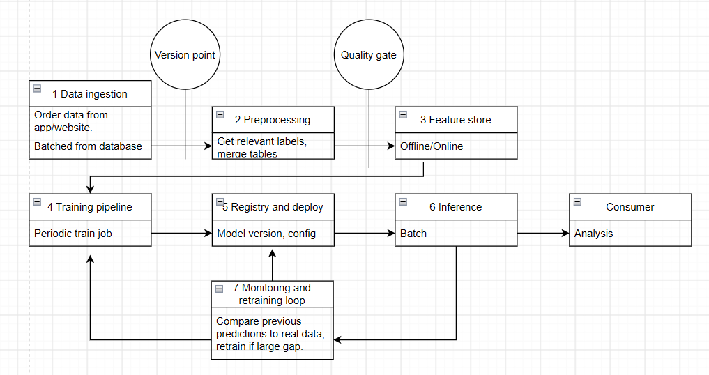
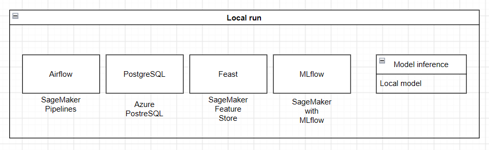
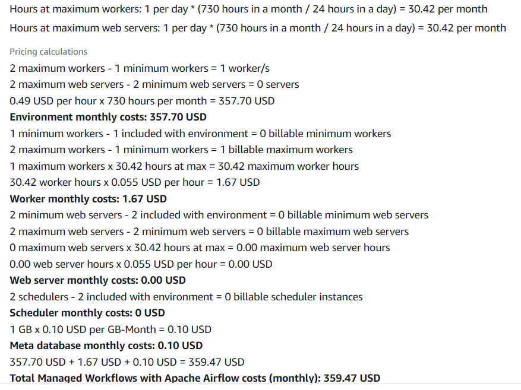
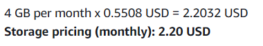
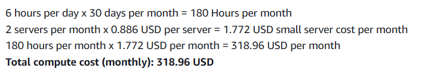

- 1 Overview. 

An ML system which predicts the sales revenue of various grocery products based on 
previous sales for the next week. 
New sales data is added daily and the model is continuously evaluated on its performance and
improved over time.

- 2 Motivation. 

Model predictions are updated weekly based on new information and can
inform inventory purchases, product marketing and discounts with minimal delay.

Large discrepancies between predicted and actual values can be seen early and the model
adjusted in turn.

- 3 Success metrics. 

Model: MSRE for weekly revenue predictions should be as low as possible. 

Bussiness: It is assumed that low model error strongly correlates with better predictive
analysis and thus better serves bussiness goals.
Revenue overestimation is prefered over underestimation.

System: Inference time should be less than 1s for a week worth of data. 
Model should be trained on new data monthly, and retrained yearly or upon request.

- 4 Requirements and constraints. 

Inputs: Order information in daily batches (timestamp, total, additional info) 
from the database. Potentially multiple tables.

Outputs: Predictions for daily orders total/revenue for the next week 
(Predicted automatically and logged).
Automatic error calculation for the previous week's predictions with notifications in cases
of significant error.

---

New predictions outputed weekly.

Model is assumed to be local to the company, so latency is not that important. 
At least 1000 ms p95 is prefered. Throughput for model predictions should be 
\> 1/10s. 

Availability should be 100% at the start of the week for inference, unimportant for the rest of the week.
Predictions should be always available through third-party databases.

Predictions should be guaranteed within 20% of each other for same input.

Model should automatically train on new data monthly and be replaced yearly or on demand.

Ground truth labels available a week after prediction.

Cost limits set by company, assumed 0 budget.

Resource ceilings set by company, assumed my laptop capabilities)

- 5.1 Problem statement. 

Forecasting. 

Regression might be suitable for the task too, but the data is assumed to 
potentially have seasonality, so forecasting is prefered.

- 5.2 Data. 

Dataset: https://www.kaggle.com/datasets/akxiit/blinkit-sales-dataset?select=blinkit_orders.csv

New datapoints arrive immediately with most labels present, model injests them in batches
daily. 
Training data is assumed the same as serving data, but at an earlier point in time.

1. A time axis. Datapoints include timestamps and can arrive continuously.

2. Enough history to hold out a period. Data spans almost 2 years in time with multiple 
datapoints per day.

3. Labels with a known arrival delay. Prediction delay depends on the model's prediction
timeframe, in this case a week.

4. A text surface or a documented corpus. Dataset includes customer order feedback.

- 5.3 Techniques. 

Baseline: Basic regression model with the order items list as input and the order total
as output.

Candidate: Forecasting model combining several datasources (orders, order items, item profit
margin, etc.) producing these outputs for each day:

1. Orders total revenue

Useful for estimating bussiness success
2. Ordered items + their count

Useful for estimating future item demand and ordering inventory.
3. Profit

Useful for calculating company financial status.

- 5.4 Experimentation and validation. 

Monthly splits. Validation by MSRE.

- 5.5 Human in the loop. 

Auto-checking for prediction drift. Alert logs are viewed by ML engineers, who decide
if it should be trained/replaced/ignored.

- 6.1 High-level design. 

- 6.2 Infra. 

Local stack and online alternatives noted in image 3 of 6.1.

Model is assumed to be local only because it's expected to be lightweight and internal
to the company.

- 6.3 Performance. 

Model is assumed to be local to the company, so latency is not that important. 
At least 1000 ms p95 is prefered. Throughput for model predictions should be 
\> 1/10s. 

Data is injested in batches even though stream is available due to low frequency of both
new datapoints and model outputs. A stream is unnecessary.

- 6.4 Security and 6.5 Data privacy. 

Service assumed internal to the company and thus its data privacy conduct
follows company guidelines for the rest of its data.

- 6.6 Monitoring and alarms. 

Model predictions saved in separate database. Logs contain basic run info and 
prediction drift/quality alerts. Alert logs are viewed by ML engineers, who decide
if it should be trained/replaced/ignored.

- 6.7 Cost.

Azure SQL Database: $122.50 Estimated monthly cost

Amazon Pipelines:

Amazon Fea. St.:

Amazon MLflow:

Assumptions stated in the images.

- 6.8 Integration points. 

Data obtained from company databases, predictions sent to analytics department.

- 6.9 Risks and uncertainties. 

Main risk is that the system deletes/changes/corrupts data in the databases it has access to.
Should be managed with proper access rights.

Risks from incorrect predictions are low because the system makes no decisions.

- 7.1 Alternatives. 

Rejected using the model to inform decisions directly as it would be too risky and 
difficult/time-consuming to train for.

Rejected several data sources due to not having precise-enough timestamp data, not including
product price or not providing any natural language features.

- 7.2 and 7.3. Placeholders; Lab 2 and Lab 4 fill them.

- 7.4 Milestones. 

1. Use case and system design.
2. Data pipelines, versioning, baseline and MLflow.
3. LLM baseline and retrieval.
4. Serving on Minikube, monitoring and drift.
5. Agentic extension.
